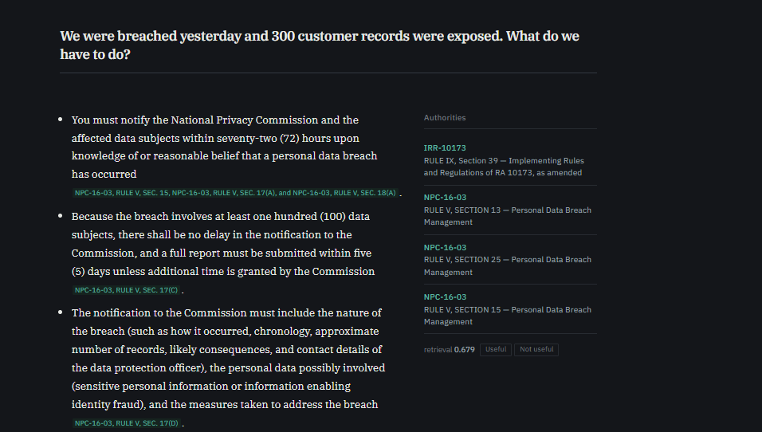
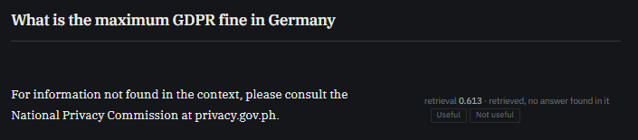

# PrivacyPH — Data Privacy Act Compliance Assistant

A retrieval-augmented assistant that answers Philippine data privacy
compliance questions for small and medium businesses, with a citation to the
governing issuance on every statement — and a refusal when the corpus does not
contain the answer.

Built because SMEs here carry real obligations under RA 10173 but rarely have
a data privacy lawyer or a full-time DPO, and the questions they ask are
repetitive and answerable from public text.

**[privacyph.vercel.app](https://privacyph.vercel.app)**



*Every statement carries the section it came from, and the authorities sit
beside the answer rather than underneath it.*



*Asked something the corpus does not cover, it says so and cites nothing. The
reading beside it — retrieved, no answer found in it — distinguishes a question
the search could not reach from one the model read and could not answer.*

> Corpus verified: 23 November 2026 · 25 issuances · 548 indexed sections

---

## What it does

**1. Grounded Q&A.** Section-level retrieval over RA 10173, its IRR, and
current NPC circulars and advisories. The model answers only from retrieved
text and cites it inline as `[NPC-16-03, RULE V, SECTION 18]`. When the
retrieved context does not answer the question, it says so and cites nothing.

**2. Breach notification wizard.** Guided intake that applies the three-element
notification test, computes the 72-hour deadline, flags the cases where no
postponement is permitted, and drafts a notification with the four required
parts. No model call — pure logic, 11 unit tests, answers in under a second.

**3. Compliance scorecard.** *(planned)* Questions across five dimensions,
scored per dimension with a prioritised gap list.

## Results

Measured by `npm run eval` over `eval/questions.csv` — 39 questions, 33
scorable and 6 deliberately out of corpus. Raw per-question output is committed
under `eval/results/`.

| Metric | Result | |
|---|---|---|
| Retrieval accuracy | **93.9%** | 31/33 — governing issuance present in the retrieved set |
| Top-1 accuracy | **57.6%** | 19/33 — governing issuance ranked first |
| Multi-hop coverage | **72.7%** | 8/11 — both issuances found where two are needed |
| Marker compliance | **100%** | 6/6 out-of-corpus questions declined *with* the refusal marker — see Limitations |
| English / Tagalog | 92.6% / 100% | 25/27 and 6/6 |
| Unit tests | 19 passing | breach logic and chunker |

The questions do not name the issuance they are looking for. "Do we have to
tell the NPC anything about the systems we run?" rather than "which circular
governs registration" — which is how a DPO actually asks, and considerably
harder to retrieve against. An earlier 16-question version of this benchmark
scored 100%, and that number meant very little: several of its questions named
the circular in the question.

### The refusal is not done by the threshold

All six out-of-corpus questions were declined — and **none of them was caught
by the retrieval floor**. Every one scored above it and was refused by the
model after reading what came back.

| | Cosine similarity |
|---|---|
| On-topic questions | 0.614 – 0.750 |
| Out-of-corpus controls | 0.506 – 0.724 |

The ranges overlap, and not marginally: *"What does Singapore's PDPA require
for breach notification?"* scored **0.724**, higher than fourteen legitimate
questions. On a corpus where every document shares one legal register, a
plausible-sounding foreign statute is lexically indistinguishable from a real
one.

So `MIN_SIMILARITY` cannot be the defence, and raising it would reject good
questions before it rejected that one. The model-level `INSUFFICIENT_CONTEXT`
check is what actually prevents fabricated answers; the floor is a backstop for
the case where retrieval returns nothing at all.

### What the two misses have in common

Both failures share one cause, which the per-question CSV makes visible:

- *"A breach exposed CCTV footage of our customers. What are our duties?"* →
  retrieved the CCTV circular, missed breach management entirely.
- *"Our cloud provider stores our data in Singapore. Is that allowed?"* →
  retrieved the security circular, missed cross-border transfers.

In both, the question's vocabulary points at one domain while the governing
issuance sits under a legal term the question never uses — it says "stores in
Singapore", not "cross-border transfer". Rephrased as *"we share customer data
with a partner company abroad"*, the same cross-border advisory is retrieved
first. This is lexical mismatch rather than a ranking problem, which pointed at
hybrid retrieval as the next intervention rather than more tuning of
`RETRIEVAL_TOP_K`. So it was built and measured. It lost.

### Hybrid retrieval was built, measured, and is not the default

`supabase/hybrid.sql` adds a `tsvector` column over the same chunks and fuses
dense and lexical rankings with Reciprocal Rank Fusion (k = 60). It runs behind
a flag — `npm run eval -- --mode=hybrid` — because the benchmark says dense is
better:

| Metric | dense *(default)* | hybrid |
|---|---|---|
| Retrieval accuracy | **93.9%** (31/33) | 87.9% (29/33) |
| Top-1 accuracy | 57.6% (19/33) | 57.6% (19/33) |
| Multi-hop coverage | **72.7%** (8/11) | 63.6% (7/11) |
| English | **92.6%** (25/27) | 88.9% (24/27) |
| Tagalog | **100%** (6/6) | 83.3% (5/6) |

The aggregate hides the interesting part. Hybrid fixed exactly the question it
was designed for — *"A breach exposed CCTV footage of our customers"* now
retrieves breach management, which dense missed. It did not fix the other
lexical-mismatch miss. And it broke three questions dense had answered,
including the only Tagalog failure in either run: *"Magkano ang multa kapag
hindi kami nag-register sa NPC?"*

That Tagalog regression is the predicted one. The full-text configuration is
`english`, so a Tagalog question contributes almost no usable lexemes while the
few that survive stemming — proper nouns, `NPC` — pull the lexical ranking
toward documents that merely mention them. On English questions the lexical
side is a second opinion; on Tagalog questions it is noise with a vote.

One intervention, one question fixed, three broken. The honest conclusion is
that lexical fusion is the wrong tool for this corpus as configured, not that
it needs another round of tuning — every document here shares one legal
register, so term overlap carries much less signal than it would across a
heterogeneous corpus. A language-aware full-text configuration, or restricting
fusion to questions that look like citation lookups, would be the next thing to
measure. Neither is implemented, because neither has been measured.

The code stays in the repository. A negative result that is reproducible is
worth more than a deleted branch.

### Tagalog

Six Tagalog questions, all retrieved correctly. The sample is too small to
claim parity, but it is evidence against the obvious worry — that a Tagalog
question against an English corpus would degrade retrieval — and the harness
now scores the two languages separately so a regression would show.

## Design decisions worth defending

**Section-aware chunking with a fallback strategy.** Fixed-size chunking cuts
across section boundaries, which is particularly destructive on statutes: a
question about the 72-hour notification window should retrieve one whole
section, not the tail of one and the head of another. `src/lib/chunk.ts`
splits on the structural markers these issuances use (`RULE V`, `SECTION 18`,
`Sec. 3`). Two of the 25 documents — the 2017-era advisories — carry no section
numbers at all, only bare title lines, so when the marker pass finds too few
sections to be believable, a heading pass runs instead. Measured across the
corpus: 23 documents parse by marker, 2 by heading.

**Running heads are stripped before chunking.** PDF extraction repeats the
document title and date on every page. Left in, they land inside section
bodies and let a query match a page header rather than the provision it was
looking for.

**Supersession is passed as context, not retrieved.** `match_chunks` filters
out issuances that have been replaced — correct for "what are the rules", and
exactly what makes "is the 2020 CCTV advisory still in force?" unanswerable,
since only the filtered-out rows can answer it. The replacement table is three
rows that change about once a year, so it is cached and passed with every
prompt. The data was always in the database; it just never reached the model.

**Graceful degradation when generation fails.** Retrieval and generation fail
independently. When every generation model is unavailable — routine on a free
tier — the retrieval result is still correct, so the assistant returns the full
text of the governing provisions with their citations instead of an error. On
a legal question the source text is arguably the better answer anyway.

**Superseded issuances are kept, not deleted.** `is_current = false` with
`superseded_by` set, filtered out of retrieval but preserved in the record.
Deleting them would throw away the audit trail.

**No citations behind a refusal.** An honest refusal and a confident answer are
both just text to the server. Attaching a Sources list to "I do not have this"
implies those sources support something. The model emits an explicit marker,
and the server suppresses citations when it sees it.

## Stack

| Layer | Choice | Why |
|---|---|---|
| Frontend + API | Next.js 15 (App Router), TypeScript | One deployable unit; API routes keep keys server-side |
| Database + vectors | Supabase Postgres + pgvector | One store for corpus, embeddings and logs |
| Auth | Supabase Auth with RLS | Row-level policies; see `supabase/schema.sql` |
| Embeddings | `gemini-embedding-001` at 1536 dimensions | Matryoshka output sizing matches `vector(1536)` |
| Generation | Gemini, native endpoint, model fallback chain | Free tier; chain ordered by measurement |

## Setup

```bash
npm install
cp .env.example .env.local
npm run setup-env          # prompts for the three credentials
```

1. Create a Supabase project. Run `supabase/schema.sql`, then
   `supabase/grants.sql`, in the SQL Editor. `supabase/hybrid.sql` is optional
   and only needed to reproduce the hybrid comparison above; the app does not
   use it by default.
2. `npm run fetch-corpus` — downloads 24 of the 25 PDFs. RA 10173 is served
   from behind Cloudflare and must be saved by hand; the script prints the link.
3. `npm run ingest` — chunks, embeds and loads the corpus (~6 minutes).
4. `npm run dev` — http://localhost:3000

Useful while working:

```bash
npm test                                           # 19 unit tests
npm run eval                                       # retrieval benchmark (dense)
npm run eval -- --mode=hybrid                      # the same benchmark, hybrid
node scripts/inspect-chunks.mjs                    # chunking report, no API cost
node --env-file=.env.local scripts/list-models.mjs # what the key can actually use
node --env-file=.env.local scripts/probe-gemini.mjs
```

`scripts/inspect-chunks.mjs` is the one to reach for first when retrieval looks
wrong: it reports sections per document and flags any document the chunker
failed to understand, without spending a single embedding call.

## Corpus

25 issuances, listed with their sources in `docs/corpus-sources.md`, which is
generated from `docs/corpus.json`. The PDFs themselves are not committed —
every one is public and re-fetchable with `npm run fetch-corpus`.

Includes RA 10173 and its IRR; the breach management, security, consent,
legitimate interest, administrative fines, registration, CCTV, identification
card, data sharing and loan-related circulars; and advisories on deceptive
design patterns, cross-border transfers, AI systems processing personal data,
data scraping, DPO designation and privacy impact assessments. Three superseded
issuances are retained with their replacements recorded.

## Limitations

- General information, not legal advice. The UI says so on every page.
- The corpus is a snapshot. Amendments to RA 10173 have been pending in
  Congress across several sessions, and the NPC issues new circulars regularly.
- The benchmark is 39 questions and self-authored. Written by the same person
  who built the retriever, which is a real limit on what it can prove.
- Answer correctness is scored by hand. An LLM judge would need validating
  against the manual scores before it could be trusted.
- Free-tier generation is frequently rate-limited; the degradation path exists
  because of it.
- **Refusal and the refusal marker are two different things, and the second
  one fails.** Asked *"What is the maximum GDPR fine for a company in
  Germany?"*, the model declined — *"I do not have the answer to your
  question"* — but did not emit the `INSUFFICIENT_CONTEXT` marker that rule 8
  requires. The answer was safe; the protocol was not. In the app that marker
  is what suppresses the citation list, so a refusal without it renders four
  sources underneath, implying they support a conclusion that was never
  reached. The benchmark counts the marker, so what it reports as "refusal
  accuracy" is really marker compliance; it now says so, and prints any
  unmarked control for a human to read instead of scoring it automatically.
  Open issue.
- Not built for real client data. RLS confines users to their own rows, but
  this has had no security review.

## Before deploying

- [ ] **Rotate both credentials.** The Supabase secret key and the Gemini API
      key used during development were pasted into a chat and a screenshot
      while setting this up. Create replacements, update `.env.local` via
      `npm run setup-env`, delete the old ones, and do not paste or screenshot
      the new values anywhere.
- [ ] Run the Supabase security advisor and confirm RLS is reported clean on
      all six tables.
- [ ] Confirm `.env.local` is untracked: `git status --porcelain .env.local`
      should print nothing.
- [x] Set the same environment variables in Vercel; none of the secret ones
      prefixed `NEXT_PUBLIC_`.
- [ ] Give production its own credentials. Deployed with the development keys
      to ship; separate keys mean a leak in one place does not reach the other.
- [ ] Free Supabase projects pause after a week of inactivity. Decide how the
      demo stays awake, or note the wake-up delay in the project description.

## Deployment

Pushing to `main` deploys. Environment variables live in Vercel project
settings and are not read from the repository.

`DEV_DNS_SERVERS` is local only and must never be set in Vercel. It exists
because the machine this was built on has a virtual network adapter whose DNS
resolver answers nothing, and Windows prefers it; the override makes Node
resolve through 1.1.1.1 instead. A deployment has no such problem.

## Roadmap

- [x] Expand the benchmark: paraphrased questions, multi-hop questions, a
      Tagalog subset scored separately
- [x] Hybrid lexical + dense retrieval — built, measured, rejected as the
      default (see above); kept behind `--mode=hybrid`
- [ ] A language-aware full-text configuration, so the lexical side stops
      penalising Tagalog questions, then re-measure the hybrid comparison
- [ ] Make the refusal marker reliable, or detect refusal from the answer
      rather than from a prefix the model has to remember to write
- [ ] Admin dashboard: query volume, unanswered questions, feedback, confidence
      distribution
- [ ] Compliance scorecard across five dimensions
- [ ] Breach wizard PDF export
- [ ] A/B the newer `gemini-embedding-2` against `gemini-embedding-001` —
      re-ingest in full and compare retrieval accuracy, since vectors from
      different models are not comparable
- [ ] LLM-as-judge for answer correctness, validated against the manual scores
